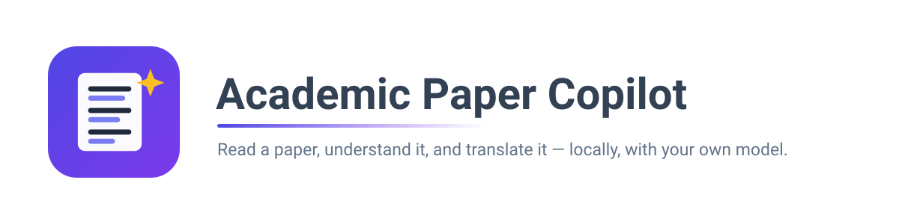
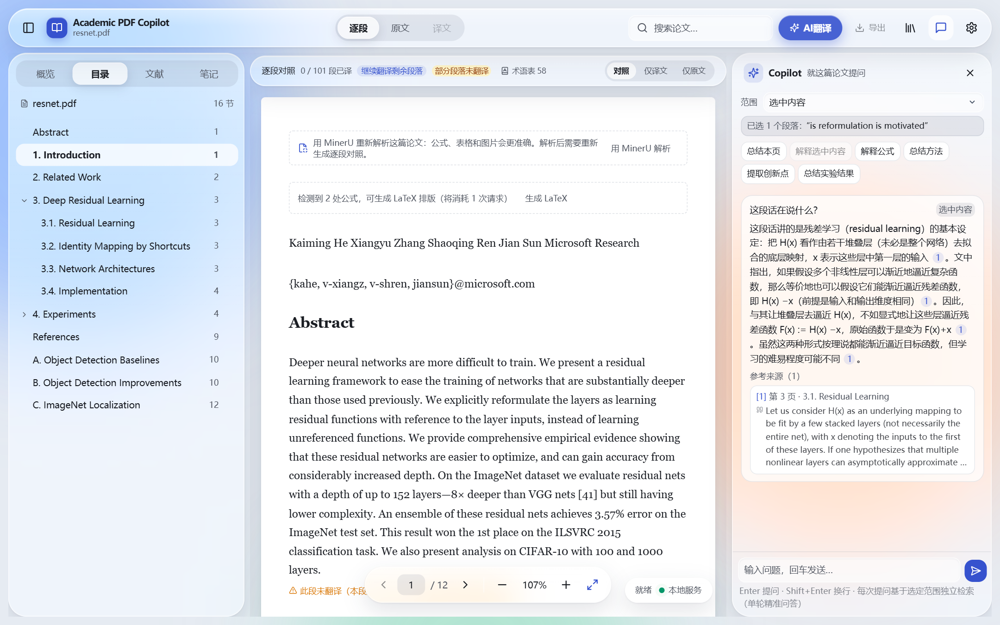
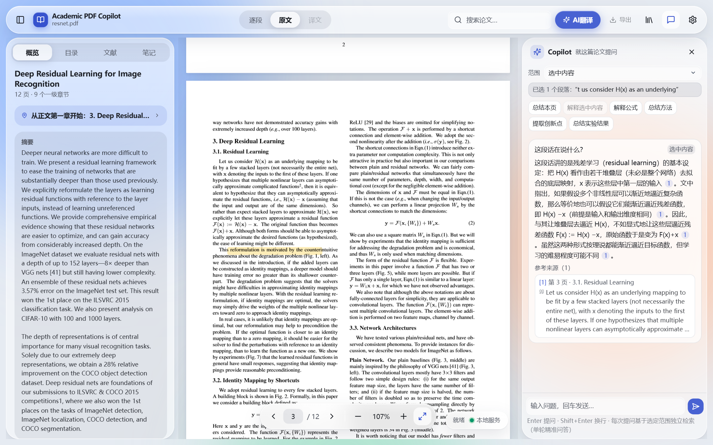
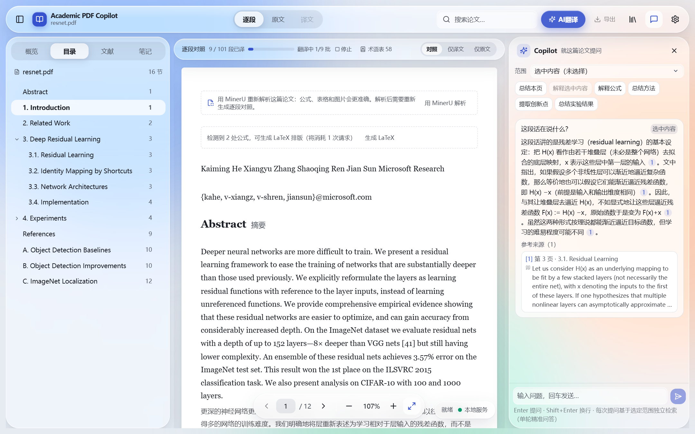
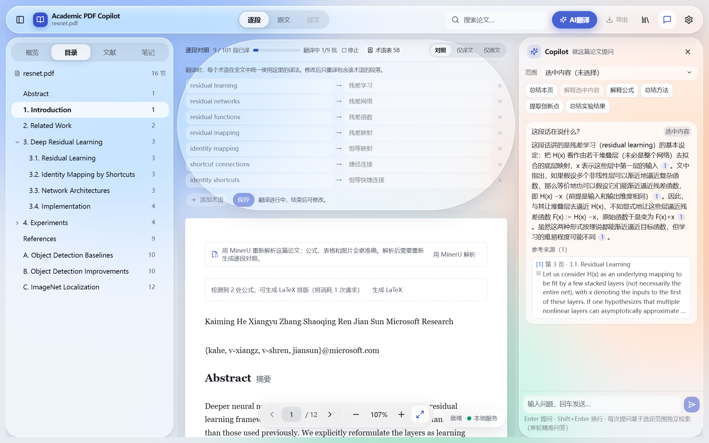
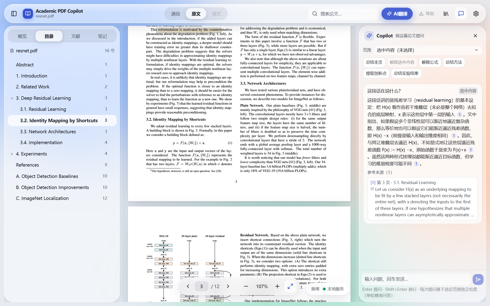
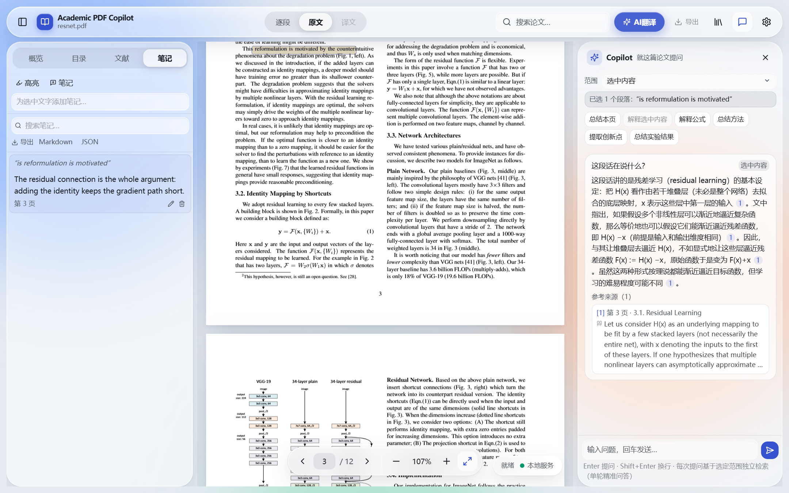
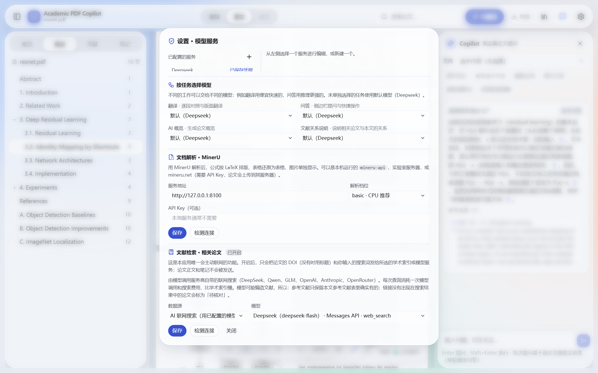
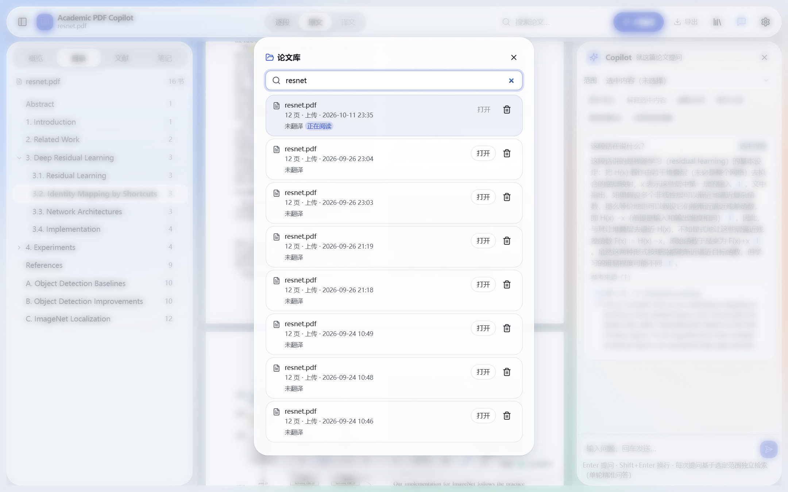
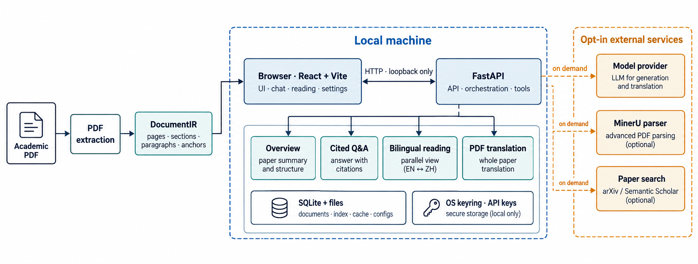

<div align="center">
  
</div>

<p align="center">
  <a href="LICENSE"></a>
  
  
  
  
  
</p>

<p align="center">
  <b>Read a paper, understand it, and translate it — on your own machine, with your own model.</b>
</p>

<p align="center">
  <b>English</b> · <a href="README.zh-CN.md">简体中文</a>
</p>

---

Academic Paper Copilot is a local-first reader for academic PDFs. It keeps the paper you are
reading in front of you — the original, not a re-typed copy — and builds everything else
around it: an extracted structure, an answer engine that cites the paragraphs it used, your
own notes and highlights, a translation of the whole paper, a paragraph-by-paragraph reading
of it in one column, and a short orientation written for a reader rather than for a machine.

Three things can leave this machine, and never by themselves: the model calls you press a button
for; a paper you hand to a MinerU parser, if you configure one (a local one keeps it on your
machine); and the DOI or title of the paper you are reading, plus any search terms you type, if you
switch related-paper search on. There is no account, no telemetry, no cloud sync, and no CDN: the
browser talks to a loopback backend, the backend talks to the endpoints you configured, and that is
the whole of the network surface.

## Contents

- [What's new](#whats-new)
- [What it does](#what-it-does)
- [Screenshots](#screenshots)
- [Quick start](#quick-start)
- [Configuring a model service](#configuring-a-model-service)
- [How it works](#how-it-works)
- [Reading continuity](#reading-continuity)
- [Evidence, not adjectives](#evidence-not-adjectives)
- [Testing](#testing)
- [Repository layout](#repository-layout)
- [Roadmap](#roadmap)
- [Contributing](#contributing)
- [License](#license)
- [Acknowledgements](#acknowledgements)

## What's new

**2026-10-12**

- **A translation appears a paragraph at a time.** A batch's answer is read as the model writes it,
  and each paragraph is shown the moment its own translation is whole and checked — not when the
  other fourteen are. The first batch is three paragraphs, so the opening arrives in seconds, and
  the glossary is read *beside* the translation instead of before it. Measured on a paper never
  translated before (92 paragraphs, a reasoning model): the first paragraph at 11 s, the screen
  updating 45 times on the way to the end, where it used to update once per batch.
- **A reading survives the paper being parsed again.** A converter upgrade rebuilds a MinerU parse
  from the result already on disk; and when an extraction changes, paragraphs whose text did not
  change keep their translations — only what is really new is translated again. (Before this, both
  cases asked for the whole paper to be paid for twice.)
- **`[24]` is a link.** In the paragraph reading a citation shows its reference on hover, scrolls
  to it on click, and offers the way back.
- **Tables fit the column, or scroll at their own size.** After a MinerU parse a table is laid out
  by a measured rule — as extracted, with wrapped prose cells, scaled down to 70 % and never below
  11 px, or at natural size in its own scroller — with numeric columns aligned and a copy-as-table
  control. The paper's own bold, italic and superscript are drawn too.
- **Dark theme**, chosen in settings or followed from the system. Body, secondary and status text
  are checked at WCAG AA in both themes from the shipped tokens. A PDF page stays as printed.
- **Smaller things.** 解释选中内容 works once there is a selection; the glossary can be extracted
  again (as a proposal) and points out related terms when one is changed; the translated count no
  longer counts the bibliography; 重译此段 is reachable from the keyboard.

What was *not* done is in the [Roadmap](#roadmap); how tables are drawn, and why, is in
[`DS-DOC-011-disposition.md`](docs/acceptance/DS-DOC-011-disposition.md).

## What it does

**概览 · Reader Overview.** Opening a paper shows a deterministic orientation built from the
extraction the application already holds: title, the abstract verbatim, page and section
counts, and a recommendation for where to start reading. Asking for an AI overview runs one
bounded synthesis call that produces short, evidence-cited items — research question, core
idea, contributions, method, experiments, findings, limitations — in Chinese or English, with
every item linked to the page it came from. The result is cached **by the paper's content
hash**, so the same PDF reopened later, or re-imported after deletion, is free.

**目录 · Outline, 笔记 · Notes.** A section tree that follows your reading position; notes and
highlights anchored to the text you selected, which survive re-extraction, re-import, and restart
because they are keyed to the document's content rather than to a database row.

**Copilot.** Asking about a paper no longer displaces the outline: the question box has its own
column on the right, toggled from the top bar. It answers from retrieved paragraphs, cites them,
and says when the evidence is insufficient rather than guessing. Select a passage and
**解释选中内容** asks about exactly that.

**Translation.** Whole-paper translation through a local PDF translation kernel, producing a
translated document and a 2N-page interleaved original/translation artifact for export. The
paragraph-by-paragraph reading is translated as a **background job**: it fills in **paragraph by
paragraph** — each one shown and written to disk as the model finishes it, in batches of which two
run at once by default (at most four) — **停止** keeps what has already been paid for, and a stopped
or failed run offers **继续翻译剩余段落** instead of starting over. Any one paragraph can be
re-translated on its own — one call, from the paragraph's own control. Every paper also gets its own
**术语表**: the terms it is translated with, listed with their translations and corrected in one
place. It is read alongside the translation rather than ahead of it; paragraphs translated before it
arrived that disagree with it are translated once more. Saving a correction spends nothing and says
how many paragraphs it affected; only those are translated again. A reading is kept when the paper
is parsed again: paragraphs whose text is unchanged carry their translations across.

**逐段对照 · Paragraph-aligned reading.** The paper reflowed into one readable column: the
prose set at a reading measure with each paragraph's translation directly beneath it, and
everything whose pixels *are* the content — figures, tables, display formulas, their captions —
carried as crops of the paper's own pages, magnified from the vector source rather than
stretched. Headings come from the sections the extractor derived (never from the layout class
that calls a table sub-label a title), the bibliography is kept in the original and says so,
and captions are placed by convention — figures below, tables above. A citation such as `[24]` is
a link to its bibliography entry, with the way back offered after the jump. The translation is
generated once per paper, in bounded batches, and cached by content hash.

**公式重建 · Formulas, typeset.** A display formula in a PDF is a picture: its extracted text
is glyph soup (`LInfoNCE = −1 / 2B / B / X / i=1` is a sum with its bounds flattened onto the
next line), so this application *reconstructs* the LaTeX from that soup and the prose around
it, and typesets it with a locally bundled KaTeX. Because a reconstruction can be wrong in a
way that looks right, every one is badged **AI 重建** and one click shows the paper's own crop,
labelled, and one click returns. The model may refuse — a formula it cannot read keeps the
paper's pixels rather than a plausible guess — and anything that does not parse is never
rendered at all. One call per 15 formulas, cached by the paper's content hash, disclosed
before it is spent. Inline `$…$` is protected rather than reconstructed: a paragraph leaves for the
model with each formula replaced by a `⟦mN⟧` placeholder, and a translation that loses, repeats or
invents one is rejected instead of displayed.

**解析后端 · MinerU, optional.** The built-in extractor (PyMuPDF plus a local layout model) stays
the default and still runs on first read. Point the app at a
[MinerU](https://github.com/opendatalab/MinerU) server — a local one, a lab machine, or mineru.net —
and a paper can be re-parsed by it instead: real LaTeX for display *and* inline formulas, tables that
come back as tables, headings the built-in extractor misses. **MinerU is reached over HTTP and never
installed into this application**; its tier (`flash` · `basic` · `standard` · `advanced`) is the
profile's model field, and it is never the default. What it returned is kept beside the document, so
when the converter improves the paper is rebuilt from it automatically — no second parse. Its tables
are fitted to the column or scrolled at their own size, and the paper's own bold, italic and
superscript are drawn. Everything it recovers is badged **MinerU 识别**, and one
click puts the paper's own crop back — a parser can be wrong, and the page is always one click away.
Pointing it at mineru.net means uploading the paper to their server, and the setting says so before
you save it.

**相关论文 · Related papers, opt-in.** A 文献 tab lists the paper's references, the works that cite
it, and similar work, each linked back to the paper's own bibliography and to the sentence that
cites it, with one click to import an open-access PDF into the library. It is the one feature that
queries the network from opening a panel rather than from a button press, and it is **off until you
add a search profile** — OpenAlex, Semantic Scholar, or a chat model whose service runs web search
server-side. What is sent is the paper's DOI (or arXiv id, else its title) and the terms you type;
body text and notes are not. A paper the model reports whose link was not among what the search
returned is marked **待核对** rather than trusted.

**论文库 · Library.** Every paper the application has registered, what each one has
(a translation, an overview, notes), and the record of the last successful translation —
language pair, engine, when. Opening a row adopts the existing paper rather than re-importing
it, so switching costs nothing and mints no duplicate.

**设置 · Provider settings.** Create, edit, delete and probe model service profiles from the
UI. A profile is a row in SQLite and now carries a **kind** — chat (`llm`), parser (`parser`), or
search (`search`) — and **the API key is written to the operating system's credential store and
never to the database**: the client is only ever told whether a key is set, and shown a mask. A key
is optional, because a local OpenAI-compatible server needs none. A second screen lets each kind of
work use a different profile — cheap and fast for 翻译, stronger for 问答 — with everything following
the default until you say otherwise; the choices persist as profile ids, never as key material.
**外观** switches between light, dark, and the system's own choice.

> **Language note.** The interface is Chinese-first (简体中文). The Reader Overview can be
> generated in Chinese or English; the rest of the UI is not yet localised.

## Screenshots

Every shot below is the same paper — **Deep Residual Learning for Image Recognition**
([arXiv:1512.03385](https://arxiv.org/abs/1512.03385)), a public one — read in the running
application, with the interface in its Chinese-first default. They are taken by
[`frontend/scripts/capture-readme.mjs`](frontend/scripts/capture-readme.mjs), which registers its own
copy through the UI, photographs it, and deletes it again. The translation shot is taken **while the
job is still running** (9 of 101 paragraphs, batch 1 of 9): a screenshot of a job that cannot be
interrupted would be a claim rather than a picture.

| 逐段 · the paragraph reading | Copilot · a selection, answered where it came from |
|---|---|
|  |  |

| 逐段翻译 · a translation job, mid-flight | 术语表 · the terms this paper translates once |
|---|---|
|  |  |

| 目录 · the table of contents, following the reading | 笔记 · a note anchored to a highlight |
|---|---|
|  |  |

| 设置 · a profile per kind of work | 论文库 · the library and its search |
|---|---|
|  |  |

## Quick start

**Requirements.** Python **3.12** (the extraction library's supported range — the backend is
pinned to it), Node **20+**, and a PDF. Windows, macOS and Linux all work; the commands below
show the Windows layout and the POSIX one where they differ.

### 1. Backend

```bash
# Windows
uv pip install --python backend/.venv/Scripts/python.exe -e "backend[dev]"
cd backend && .venv/Scripts/python -m uvicorn app.main:app --host 127.0.0.1 --port 8000 \
    --no-server-header --no-date-header

# macOS / Linux
uv pip install --python backend/.venv/bin/python -e "backend[dev]"
cd backend && .venv/bin/python -m uvicorn app.main:app --host 127.0.0.1 --port 8000 \
    --no-server-header --no-date-header
```

```bash
curl -i http://127.0.0.1:8000/api/health
# {"status":"ok","version":"0.1.0"}
```

The service refuses to bind anywhere but loopback, and its own settings model rejects a
non-loopback host, so a mistake fails at startup instead of quietly exposing the service.

### 2. Frontend

```bash
cd frontend
npm install
npm run dev          # http://127.0.0.1:5173
```

Open the address, drop a PDF into the reader, and the application extracts its structure and
shows the reading entry. No model call happens until you ask for one.

On Windows, `start.bat` at the repository root does all three steps — backend, frontend, browser:

```bat
start.bat
```

### 3. Where your data lives

| What | Where |
|---|---|
| Documents, extractions, translations | `<data dir>/documents/<document_id>/` |
| Overview cache (content-addressed) | `<data dir>/documents/_cache/overview/` |
| Notes, highlights, profiles, tasks | `<data dir>/db.sqlite3` |
| API keys | the OS credential store (`keyring`) — never the database |

`<data dir>` is `%LOCALAPPDATA%\AcademicPDFCopilot` on Windows and
`~/.local/share/AcademicPDFCopilot` on Linux/macOS.

### 4. Desktop app (Windows)

The same application ships as a single desktop program: one window, one local backend started
and stopped by the shell, no browser and no second terminal. Prebuilt downloads are on the
[releases page](https://github.com/Marastraluster/Academic-Paper-Copilot/releases/latest) — an
installer, and a zip for machines where nothing may be installed. See
[docs/DESKTOP.md](docs/DESKTOP.md) for the full account.

```powershell
pwsh ./scripts/build-desktop.ps1      # icon → frontend → frozen backend → installer
```

Output lands in `desktop/release/`: an NSIS installer and a zip of the same app for machines where
nothing may be installed (extract once, run the `.exe` inside). To run the desktop shell from
source while changing code:

```powershell
pwsh ./scripts/run-desktop.ps1        # or: start-desktop.bat
```

The desktop build serves the frontend from the backend's own origin, so there is no CORS
configuration, no port to agree on at build time, and the window is the only client.

## Configuring a model service

Open the top bar's **设置** screen and add a profile: a name, the endpoint, the model, and —
optionally — a key. **测试连接** probes the endpoint on demand and reports what it found;
nothing is probed on open, on selection, or on save.

The same screen groups profiles by kind. A **parser** profile points at a MinerU server, and its
model field is the parse tier; a **search** profile is what switches related papers on; the
**按任务选择模型** screen decides which chat profile each kind of work uses. The setting screens for
all three state what turning them on would send, before they send it.

A profile can also be created from a terminal, which is useful on a machine with no browser
session. The key is read without echo and written straight to the credential store:

```bash
python backend/scripts/configure_provider.py
# or, unattended, from a variable you set in your own shell:
python backend/scripts/configure_provider.py --name Local \
    --base-url http://127.0.0.1:11434/v1 --model qwen2.5:7b --keyless
```

## How it works




Five ideas carry most of the design:

**The extraction is the spine.** Every feature — outline, questions, notes, overview,
translation context — resolves against one `DocumentIR`: pages, sections, paragraphs, text
blocks, and the anchors that make a piece of text identifiable across re-extraction. Which
extractor produced that IR is a boundary, not a flag: the built-in one, or an optional MinerU
parse, with nothing above the boundary knowing which.

**Identity is the content, not the row.** A PDF's SHA-256 is what the overview cache, the
notes, the search index and the translation artifacts are keyed to. That is why re-importing a
paper you deleted brings your notes back, and why reopening the same bytes never pays twice.
Document rows are disposable; content is not.

**Cost is a design constraint, not an afterthought.** Opening a paper, reading a cached
overview, switching papers, restoring a session after a reload, listing the library — all of
it is measured to be **zero** provider calls, against a ledger that wraps every provider the
application can construct. Only a button press spends anything, and the button says so first.
A background job spends in batches, and it writes each batch to disk before asking for the
next one, so stopping it costs nothing that has not already been delivered.

**The network surface is opt-in, and stated.** Two features can reach out on their own — a
MinerU parse and related-paper search — and both are off until a profile exists, both name what
they would send in the screen that turns them on, and the related-paper endpoint answers
`409 SEARCH_NOT_CONFIGURED` rather than doing anything at all while it is off.

**Nothing is displayed that was not measured.** The overview shows the model that produced it
and the tokens the provider reported — or says the count is unavailable. The library shows the
language pair and the engine of the last successful translation, and shows no model, no tokens
and no latency, because neither is recorded. The acceptance documents carry this rule into the
tests themselves.

## Reading continuity

A reload used to close the paper. It no longer does: the session — which paper, which page,
which mode, which panel — is stored locally and restored on load, adopting the existing
document rather than re-importing it, so the translation, the notes and the cached overview
are all still there. Closing a paper deliberately forgets the session, so an empty workspace
is a state you can choose and keep.

A translation survives more than a reload: it runs as a server-side job whose batches are on
disk, so closing the window, reloading, or restarting the backend leaves the finished
paragraphs translated and the rest resumable. The session record also remembers the 文献 tab,
and a session saved in the retired side-by-side 双语 mode reopens on 译文 rather than breaking.

## Evidence, not adjectives

Every task in this repository began with acceptance criteria written **before** any
implementation code: numbered, falsifiable, each stating the evidence it requires. The
criteria live in [`docs/acceptance/`](docs/acceptance/) — 40+ documents, each closed with a
per-criterion status and the exact test, browser scenario or measurement behind it, including
the criteria that were amended (with reasons) and the ones that failed. Two of them have not
been implemented yet and say so: [`DS-DOC-011`](docs/acceptance/DS-DOC-011.md) is the frozen
contract for typesetting tables, and
[`ADR-003`](docs/decisions/ADR-003-extraction-backend.md) is the decision that allows a second
extraction backend at all — status *proposed*, which is why MinerU is optional and never the
default.

Two habits are worth naming, because they are the reason to trust the numbers:

- **Measurements are recorded, not remembered.** Provider calls come from a backend ledger;
  bundle size from the production build; cache behaviour from files on disk; selection
  behaviour from real Chromium drags with a mouse. Where a claim could not be measured, it is
  written down as unmeasured rather than rounded to a pass.
- **The tests are expected to catch the product, not the code.** The browser harnesses drive
  the built application with a real backend, and they have found defects that every unit test
  was happy with — including a restored page that reported page 3 to the store while the
  viewer sat on page 1.

## Testing

```bash
# Backend — 1276 tests, offline by construction
cd backend && .venv/Scripts/python -m pytest

# Frontend — 424 tests
cd frontend && npm run typecheck && npx vitest run && npm run build

# Browser acceptance — real Chromium, real backend, real PDFs
cd frontend
node scripts/e2e-overview.mjs --generate     # reader overview lifecycle
node scripts/e2e-session-continuity.mjs      # reload restores the paper
node scripts/e2e-document-library.mjs        # library, switching, deletion
node scripts/e2e-qa.mjs                      # Paper QA — and the selection drag it drives
node scripts/e2e-notes.mjs                   # notes and highlights
node scripts/e2e-notes-search.mjs            # searching them
node scripts/e2e-crosspage.mjs               # cross-page selection
node scripts/e2e-nonprose.mjs                # captions and formulas
node scripts/e2e-outline.mjs                 # outline navigation
node scripts/e2e-translation.mjs             # translation and reader modes
node scripts/e2e-reflow-bilingual.mjs        # paragraph reading and formula typesetting
node scripts/e2e-provider-settings.mjs       # profiles, probing, the credential store
```

All twelve are `node --check`-clean and each one has a top-level driver of its own that exits 0 or 1.
`scripts/e2e-selection.mjs` is deliberately absent: it is a module, not a harness — [`e2e-qa.mjs`](frontend/scripts/e2e-qa.mjs)
drives its selection-drag checks. [`docs/development.md`](docs/development.md) lists every harness with
the flags and environment variables it reads, the probes that measure rather than assert, and what each
layer of the test suite can and cannot see.

The backend suite fails any test that opens a non-loopback socket, and every test runs against
a temporary database — your real library is never touched by a test run. The features that *can*
reach the network are tested under the same rule: MinerU, OpenAlex, Semantic Scholar and
model-side web search are all exercised through an in-process transport, so the suite still opens
no non-loopback socket while covering them.

The browser harnesses copy your data directory into a scratch directory and run against the
copy. They also report the provider ledger, which is how "this cost nothing" is a measurement
rather than a promise. The formula harness runs against a loopback stub provider and fails the
run if the page requests anything that is not loopback — offline-first is a checked property
here, not a claim.

## Repository layout

```
backend/            FastAPI service
  app/document/     PDF extraction → DocumentIR, and the backend boundary
  app/mineru/       the optional MinerU parser: HTTP client, converter, staging
  app/overview/     reader overview: packet, prompt, pipeline, content-addressed cache
  app/bilingual/    paragraph translation: batched jobs, glossary, math guard, cache
  app/formulas/     LaTeX reconstruction from a formula's extracted glyph stream
  app/related/      related papers: OpenAlex, Semantic Scholar, model-side web search
  app/qa/           retrieval, expansion, answering
  app/annotations/  notes and highlights, anchored to content
  app/pdfkernel/    translation kernel adapter
  app/llm/          provider resolution, accounting ledger, sanitisation
  tests/            1276 tests
frontend/           React + Vite application
  src/pdf/          reader pane (PDF.js, windowed rendering, text layer)
  src/qa/           selection capture, scope, answers, citations
  src/overview/     reading entry, generated overview, session
  src/bilingual/    the reflowed paragraph reading (stream assembly, crops, the column)
  src/formulas/     KaTeX rendering, provenance badge, one-click comparison with the paper
  src/related/      the 文献 panel
  src/parsing/      the MinerU parse session shown in the reading column
  src/assistant/    the left sidebar and the Copilot column
  src/library/      the document library
  src/settings/     provider, parser, search and per-task model settings
  src/session/      reading continuity across reloads
  scripts/e2e-*.mjs browser acceptance harnesses
docs/
  acceptance/       the frozen criteria and the evidence for each
  decisions/        architecture decision records
  ARCHITECTURE.md   how the pieces fit
  TEST_PLAN.md      what is verified at which layer
assets/             project marks
```

## Roadmap

- **Tables for papers the built-in extractor reads** — after a MinerU parse a table is drawn as a
  table (merged cells kept, numeric columns aligned, fitted to the column or scrolled at its own
  size). That is the accepted design
  ([`DS-DOC-011` disposition](docs/acceptance/DS-DOC-011-disposition.md)); the earlier KaTeX
  proposal is withdrawn. The built-in extractor still flattens a table to text, so those papers
  show the paper's crop.
- **Inline formatting from the built-in extractor** — the paper's own bold, italic and superscript
  are carried and drawn after a MinerU parse; the built-in extractor still flattens text spans.
- **Checking what a web-searching model returns** — with DeepSeek's search, later and similar
  papers all arrive flagged 待核对, because the search returns secondary pages and the model
  answers with canonical links. Confirming them needs a second lookup, which is a decision about
  what leaves the machine, not a missing line of code.
- **Persisted run telemetry** — tokens and latency per generation, so the library's record can
  say what a translation cost instead of staying silent about it.
- **Synchronised panes** — the original and its translation scroll independently today.
- **Notes across papers** — search and export are per paper; import is not built.
- **Localised interface** — the UI is Chinese-first today; English and others to follow.
- **English UI screenshots and documentation pass.**
- **Desktop packaging** — gated on reopening ADR-002 and a Rust toolchain.

## Contributing

Issues and pull requests are welcome — see [CONTRIBUTING.md](CONTRIBUTING.md) for the two house
rules (**acceptance criteria before the code**, **measurements, not adjectives**) and
[`docs/development.md`](docs/development.md) for the day to day: which layer of the test suite sees
what, the exact commands, what counts as evidence, and when a decision needs an ADR.

## License

**GNU Affero General Public License v3.0** — see [LICENSE](LICENSE).

This is a copyleft licence, and it is not a preference: the translation kernel
([PDFMathTranslate](https://github.com/Byaidu/PDFMathTranslate)) and the PDF engine
([PyMuPDF](https://github.com/pymupdf/PyMuPDF)) are both AGPL-3.0, and this application links
them directly. AGPL-3.0 is therefore the only licence under which the combined work can be
distributed. If you fork this project, your distributed or network-hosted version must be
AGPL-3.0 as well. See [THIRD_PARTY_NOTICES.md](THIRD_PARTY_NOTICES.md) for the full list.

## Acknowledgements

- **[PDFMathTranslate](https://github.com/Byaidu/PDFMathTranslate)** — the translation kernel
  this project drives, and the reason the licence is AGPL-3.0.
- **[PyMuPDF](https://github.com/pymupdf/PyMuPDF)** — PDF parsing, rendering and text
  extraction (AGPL-3.0).
- **[MinerU](https://github.com/opendatalab/MinerU)** — the optional structural parser, called
  over HTTP and never bundled or linked into this application. Its licence is not AGPL, which is
  why the boundary is a process rather than an import; see
  [THIRD_PARTY_NOTICES.md](THIRD_PARTY_NOTICES.md).
- **[OpenAlex](https://openalex.org/)** and
  **[Semantic Scholar](https://www.semanticscholar.org/product/api)** — the opt-in
  related-paper indexes.
- **[PDF.js](https://mozilla.github.io/pdf.js/)** — the in-browser reader.
- **[React](https://react.dev/)**, **[Vite](https://vite.dev/)**, **[Zustand](https://zustand.docs.pmnd.rs/)**,
  **[FastAPI](https://fastapi.tiangolo.com/)**, **[Tailwind CSS](https://tailwindcss.com/)**,
  **[lucide](https://lucide.dev/)** — the rest of the stack.
